# Zroshua 💧

**Smart irrigation for Home Assistant** — a native add-on with a full web UI in the sidebar.
Zones on top of your existing `switch`/`valve` entities, watering groups with controlled
concurrency, a conflict-aware scheduler, weather intelligence, rain & soil sensors,
stuck-valve protection, water & energy statistics, a live site map and Telegram notifications.
The interface follows your Home Assistant language automatically — English, Українська,
Polski, Deutsch, Slovenčina, Română, Italiano, Español, Čeština, Français, 简体中文
(English fallback).


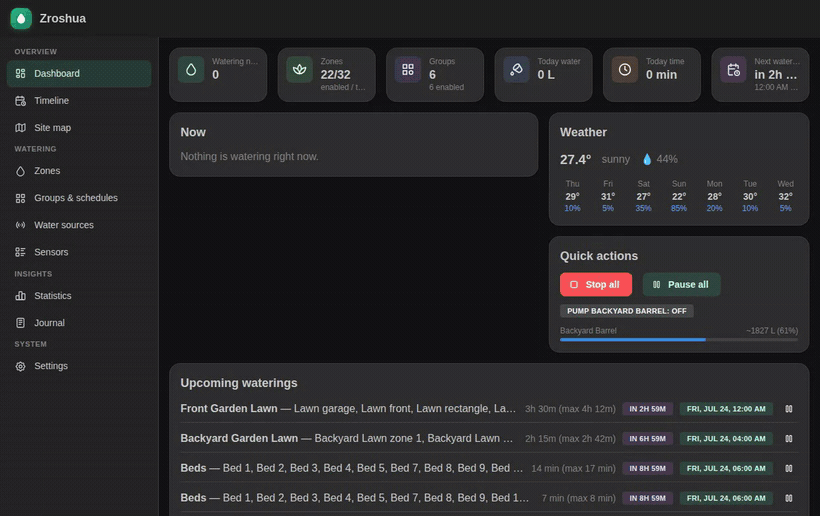

## Why an add-on (not an integration)?

- **Sidebar panel** via ingress — a mobile/tablet-friendly SPA, no custom Lovelace cards, no YAML.
- **Own process** with a Supervisor watchdog: the scheduler runs independently of the HA event
  loop and survives HA restarts (active runs are persisted and resumed).
- **Own database** for run history, skip reasons and consumption statistics.
- Controls any hardware through HA entities: ESPHome, Zigbee, Shelly, anything that is a
  `switch` or `valve`.

## Installation

One click — add this repository to your Home Assistant add-on store:

[](https://my.home-assistant.io/redirect/supervisor_add_addon_repository/?repository_url=https%3A%2F%2Fgithub.com%2FRobinCK%2Fzroshua)

Then find **Zroshua** in the store and click **Install**. Or add it manually:

1. In Home Assistant open **Settings → Add-ons → Add-on Store**.
2. Menu (⋮) → **Repositories** → add:

   ```
   https://github.com/RobinCK/zroshua
   ```

3. Find **Zroshua** in the store and click **Install** (the image is built locally on first
   install — this takes a few minutes).
4. Start the add-on — **Zroshua** appears in the sidebar.

### Add-on options

All irrigation configuration lives in the web UI and applies instantly. The add-on options
hold only system-level settings:

```yaml
log_level: info          # trace | debug | info | warning | error
database:
  driver: sqlite         # sqlite (default) | mariadb | postgres
  # host: core-mariadb   # for external databases
  # port: 3306
  # name: zroshua
  # username: zroshua
  # password: "..."
telegram_bot_token: ""   # optional, from @BotFather
```

- **sqlite** (default): everything lives in `/data`, which is included in Home Assistant
  backups — zero configuration, restore together with the rest of your system.
- **mariadb / postgres**: keep the data in an external database (use host `core-mariadb`
  for the official MariaDB add-on).
- With the **Mosquitto** add-on installed, MQTT credentials are picked up automatically
  from the Supervisor — no configuration needed.

## Tour

### Dashboard

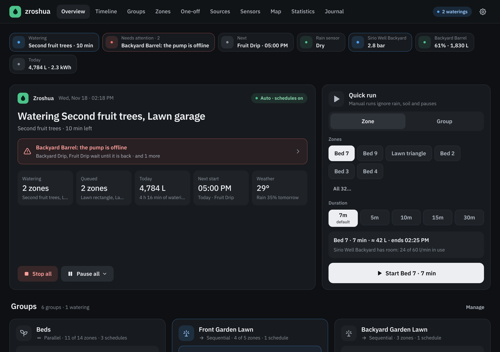

One screen that answers *what is happening, and does anything need me*. A row of **status
badges** on top — watering now, needs attention, next run, rain sensor, pump pressure, barrel
level, today's water — each opens its page. The **status card** says it in one sentence
(*Watering Second fruit trees, Lawn garage*), shows the order of the running group as a
segmented bar and the most important problem as a red line you can tap, then tiles for
watering, queued (with the **exact reason** each run waits: `sequential group busy`, `mutex
with group X`, `flow budget exceeded`…), today's water, next start and weather, and the two
buttons that matter: **Stop all** and **Pause all** — for 6, 12 or 24 hours, 3, 7 or 14 days;
manual runs still work. Beside it **Quick run**: pick a zone or a group and a duration, see
the litres, the end time and whether the source has room, start.

Below come the same cards as on a Home Assistant board: **groups** (mode, next start, run /
stop, pause), the **next 7 days** with a weather strip, **today** as a 24-hour lane per group,
**every zone** grouped by group, **water sources** and **needs attention** — what Zroshua
cannot fix itself: an offline pump, a sensor that went quiet or runs low on battery, a valve
that does not answer. Tapping a zone opens its sheet: water for a preset, stop, `+5 min`,
pause, clear a fault.

Upcoming waterings are **predicted, not just listed**: a run that would be skipped under
the current state carries a red *will skip* badge with the reason — e.g.
`rain dry-out until 09:17` while the sensor is already dry but the dry-out delay is still
counting — and a yellow *may skip* badge when it depends on data known only at start time
(forecast, live sensor conditions). The list includes **a zone's own schedules**, not only
group runs. Each row has a **pause menu**: *skip this run* (pauses just that group or zone
until the run is past), pause 6/12/24 h, or resume; a one-off run is skipped or cancelled —
so you can drop one upcoming watering straight from the dashboard. Barrel-type water sources
show a **live level** (estimated or from a level sensor) on their card and as a status badge.

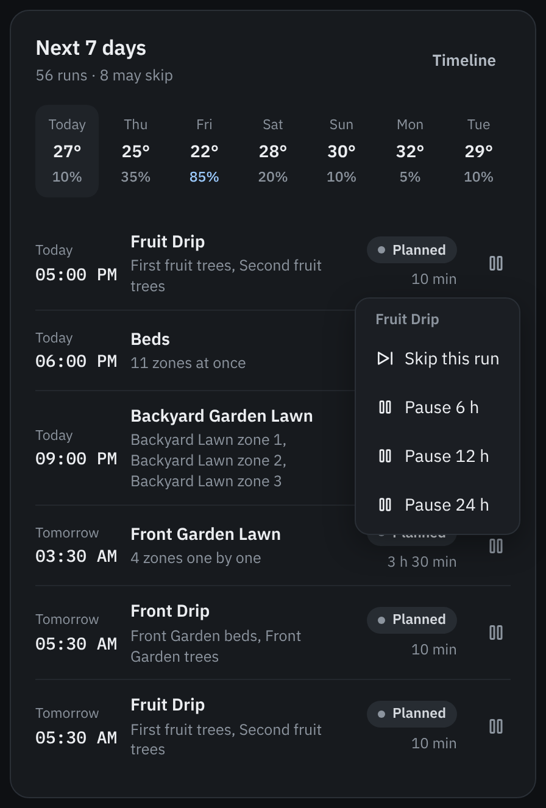

### Timeline

Each day as a 24-hour strip per group — see exactly when water is busy and when it is free.
Zones are drawn at their planned (unscaled) times — temperature scaling shifts every following
zone of the group, so bars never overlap. Each run then shows its **finish window** as a
translucent tail: medium = may finish earlier (negative scaling), faint = the worst-case
temperature boost. Gaps after the faint tail are guaranteed free time. Runs that violate a
*never-overlap / order* rule are outlined red with an alert (checked against the worst case).

The strip also says **what will actually happen**, because a slot that is reserved is not the
same as a slot that will be watered:

| Look | Meaning |
|---|---|
| Normal colour | Nothing suggests this run will be skipped. |
| **Amber** | It **will** be skipped, and that is already decided — watering is paused globally, the group is paused, all of its zones are paused, or the rain dry-out window covers the start. |
| **Muted colour** | It **may** be skipped: every reason that is re-read at start time — the forecast, temperature scaling, forecast-based run conditions, live soil sensors, "rain sensor is wet now". |

A forecast is deliberately never treated as a fact. "The forecast says 20 °C and the condition
wants ≥ 30 °C" makes a run *uncertain*, never *certain*, because the temperature at start time
is not known yet. Hovering (or tapping) a bar names the state and lists the reasons. The bar
stays in place either way — the time is still reserved until the run is actually skipped.

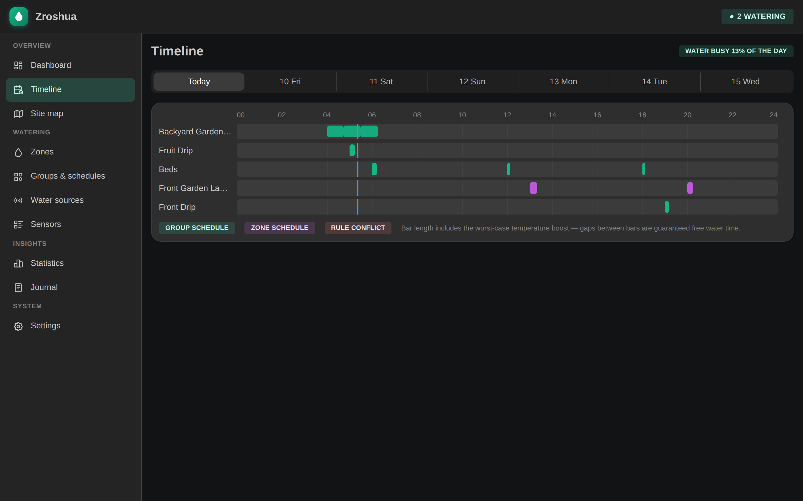

One-off runs share the strip with the schedules. They get their own row and the zone hue with a
45° hatch — not a fifth colour, because no fifth hue stays distinguishable from the existing four
for a colour-blind reader. The row label and the tooltip name them too, so the texture is never
the only clue.

### One-off watering

Sometimes the answer is not a schedule: *water these five beds tonight at 19:00, once, and forget
about it.* That is a **one-off run** — a dated, one-shot request with an absolute start time.

A wizard builds it in four steps:

1. **Zones** — pick them, each with its own minutes (prefilled from the zone's base duration).
2. **Steps** — arrange the zones into ordered steps. Zones inside one step open **at the same
   time**; steps run one after another. Each step is checked against reality while you build it:
   if the zones do not fit on their water source, the wizard says so *and* re-times the step as
   the partly serial run it will really be.
3. **When** — today, tomorrow or a date, on the same occupancy strip the schedule editor uses,
   built from the real plan for that day. "Start at" or "finish by" both work.
4. **Confirm** — the summary, an optional name, and one switch: *run even if watering is paused,
   it is raining or the soil is wet.*

A one-off is an **automatic** run, not a manual one. It waits its turn in the queue and obeys
never-overlap and order rules, source dependencies, the "source has water" sensor and the flow
budget — a manual run bypasses all of those, which is exactly what you do not want from a run
scheduled hours in advance. It obeys pauses, the rain sensor and the soil-moisture block unless
the force switch is on. It ignores the weather multiplier, temperature scaling, per-schedule run
conditions and the minimum-duration rollover: the minutes you typed are taken literally.

It appears wherever a scheduled run appears — in *Upcoming waterings*, on the timeline, in the
journal, and in both card views — and it can be skipped (it then quietly expires), edited or
cancelled. A one-off that misses its start by more than five minutes, because the controller was
busy or offline, **expires instead of watering at 03:00** what was meant for 19:00. Everything
that stops it happening is named: in the run's history row, in the journal and as a notification.

### Groups, schedules and the time-slot picker

A group is an ordered set of zones with schedules and an execution mode: **sequential**
(one zone at a time), **parallel** (all together) or **parallel with a limit**. Add an
inter-zone delay for pressure recovery, a 0–200 % duration multiplier and a priority.

Schedules support a whole-week template or **per-day start times**, several waterings per
day, a seasonal window (`MM-DD`…`MM-DD`), **per-schedule zone durations** (defaults come
from the zone), a **zone selection** (tick which of the group's zones this start waters —
so the midday refresh can hit only the two thirsty beds while the evening run does the
whole group) and **run conditions**.

Every start time is either a *start at* or a **finish by** anchor: pick *finish by* and
Zroshua computes the start from the worst-case run length (temperature boost included), so
"lawn done before the 07:00 school run" stays true even on +20 % days.

Start times are picked on a 24-hour occupancy strip: **red bands** are schedules of groups
bound to this one by rules (worst-case length included), gray bands are other schedules,
teal is this run — drawn solid for the planned length with a **hatched worst-case tail**,
so you see exactly how far a hot day can stretch it. The picker shows *free until HH:MM*
and warns live when the chosen slot overlaps a rule-bound group; saving with a conflict
shows a loud warning.

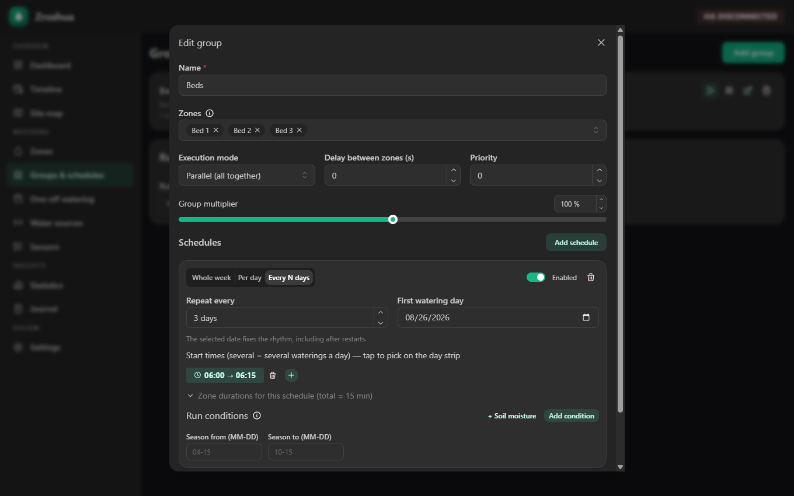
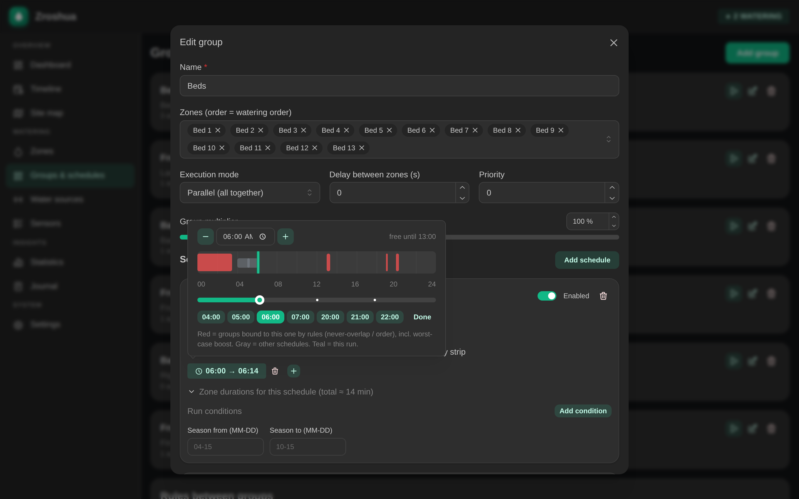

**Rules between groups** encode your hydraulics declaratively:

| Rule | Meaning |
|---|---|
| Never overlap | The groups may never run at the same time. |
| Order (A before B) | B waits until A has finished (e.g. well always before barrel). |
| May run in parallel | Explicitly allowed to overlap (drip lines). |

Rules cover what hydraulics can't express — most exclusivity you don't have to write at
all: mark two **water sources** as *never run at the same time* and every pair of groups
drawing from them is mutually exclusive automatically (see below).

What happens when a scheduled run still collides at runtime is your choice
(**Settings → conflict policy**): *wait in queue* (default) or *skip the run* for a strict
timetable — always with a journal reason.

### Run conditions

Every schedule (group or zone) can carry criteria checked at start time — all must pass:

- **Forecast max temperature today** ≥ / ≤ X °C (e.g. run the midday cooling cycle only in heat),
- **Forecast rain probability** ≥ / ≤ X %,
- **Sensor value(s)** at start time — one sensor, or **several combined** (average / min /
  max). The one-tap **Soil moisture** preset drops in a *sensor(s) ≤ %* condition.

For each condition you choose what happens when it is **not** met: **skip the run**, or
**water less** — run at a chosen % of the normal time instead of skipping. "Water less" only
*shortens* the run, so it always fits inside the reserved worst-case slot and never clashes
with another group. So the Soil-moisture preset can either skip when the bed is already moist,
or just trim the run. Either way it's safe — a **soil-moisture trigger** still waters the zone
if it dries out before the next scheduled run.

Failures are journaled and notified; **unavailable data never blocks watering** — a dead
sensor won't leave the garden dry.

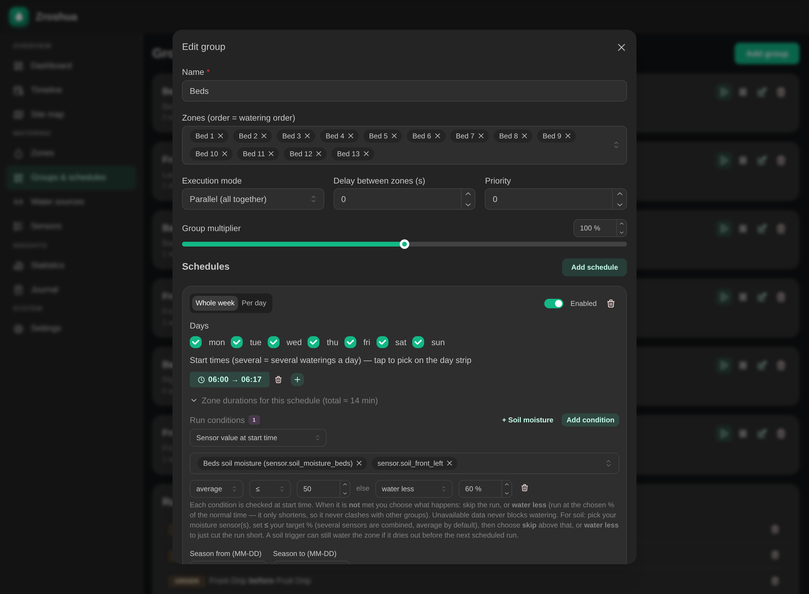

### Zones

A zone = one irrigation line: one or more HA entities switched together, a default duration
(the preset for manual runs), an optional **flow rate** (exact l/min or a min–max range) used
for statistics and flow budgets, a **max-runtime failsafe**, optional cycle & soak, per-zone
ignore flags (rain sensor / weather) and — when one bed needs more water than
its group — **own schedules** in addition to the group's.

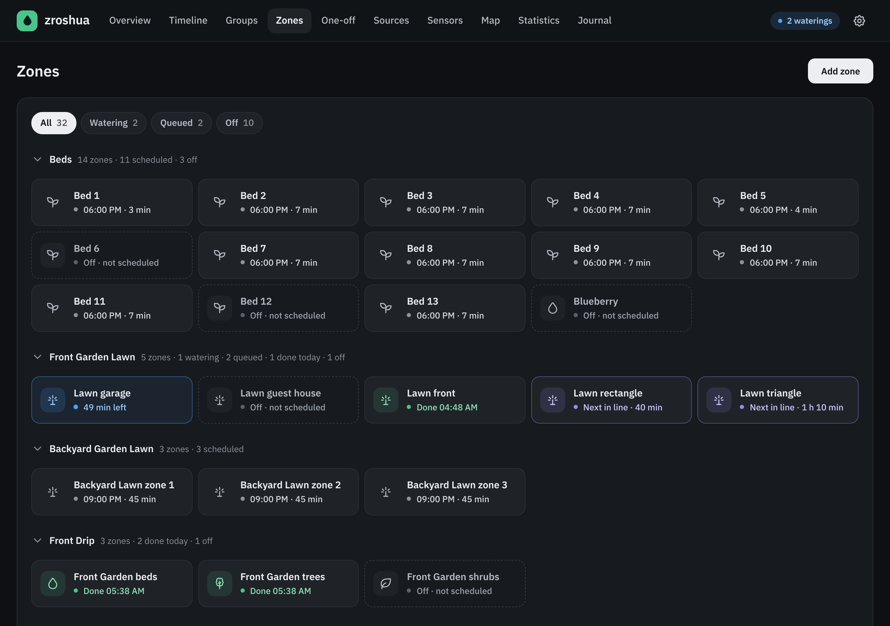

**Manual runs always start**: they ignore the rain sensor, weather and any pause; hydraulic
conflicts produce a warning, not a block. Every manual run is a timer — the zone always
switches off by itself (with the max-runtime failsafe as a second, independent layer).

**Pause** (skip without disabling): every zone and every group has a pause control — pause
its automatic runs for a chosen number of hours (3 / 6 / 12 / 24 / 48) and it resumes by
itself, or resume it manually. There is also a global *Pause all watering* on the dashboard.
A pause only skips **automatic** watering (schedules, soil and weather triggers); manual runs
still work. Use it to skip today's run for one bed or group without turning it off.

### Water sources

Sources make hydraulics first-class: a **max flow budget** (l/min — the scheduler never lets
concurrently running zones exceed it), a **pump entity** kept on while any zone of the source
runs (reference-counted, with start/stop delays), a **dependency** on another source
("blocked while that source runs"), a *water available* sensor, an optional flow sensor with
an idle-flow leak alert, an **energy meter** and a configurable **refill tail** (count pump
energy for N minutes after selected groups finish — e.g. while the barrel refills).

**Pump after a run**: choose what happens when the last zone finishes — *turn the pump off*
(default), *leave it on*, or *restore the state it had before* (only switch off if it was
off before Zroshua started it). Use *leave on* / *restore* when the pump also feeds the house
or water outlets and must not be cut. The pump doubles as a **controller availability check**:
if it is `unavailable` at start (or within the pre-start window), you get a fault
notification and the run continues best-effort.

**Pressure**: give a source a pressure sensor (bar) and a target pressure, and its card — on
the dashboard and on a Home Assistant board — shows a gauge with the target marked, next to the
pump state, the flow and what the source feeds.

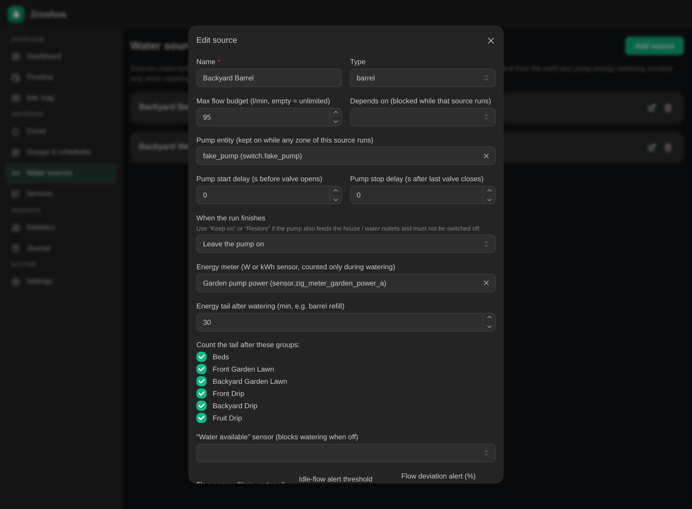

**Source exclusivity**: mark sources that must *never run at the same time* (a well pump and
a barrel pump on one power line, or a barrel refilled by the well) and the mutual exclusion
propagates to every pair of groups using them — the scheduler, the timeline conflict check
and the time-slot picker all treat it like a never-overlap rule, without writing one per
group pair.

**Volume tracking for barrels**: give a source a capacity (liters) and Zroshua keeps a live
level estimate — consumption from the flow rates of running zones, refill from a constant
refill rate — or reads an **analog level sensor (%)** directly when you have one. The level
shows on the dashboard, is published to HA as `sensor.<source>_level`, warns below a
**low-reserve** threshold and can optionally **block scheduled starts** below a critical
percentage (manual runs still work).

**Flow deviation alert**: with a flow sensor on the source, the measured flow is compared to
the sum of the running zones' expected rates; a sustained deviation beyond your threshold
raises a fault naming the direction — higher (possible burst pipe) or lower (clogged
emitters / low pressure).

### Sensors

- **Rain** — one or several `binary_sensor`s (leak sensors work great): quorum aggregation
  ("N of M must be wet"), a **dry-out delay** after the last wet signal, skip-at-start and
  stop-during-run behaviour. Zones can ignore the rain sensor individually.
- **Soil moisture** — per zone or group: water for N minutes when moisture drops below a
  threshold, then wait a **cooldown** (soil sensors react slowly); optionally block scheduled
  runs above a wet threshold; stale data is ignored safely. Each trigger can **ignore the rain
  sensor** — soil under a roof or in a greenhouse gets watered even while it rains outside.
- **Temperature (heat burst)** — give a lawn a short extra shower on hot afternoons: when a
  temperature sensor passes a threshold **inside a time window** (e.g. ≥ 30 °C between 13:00
  and 16:00), run a zone or group for N minutes, then hold a cooldown. Respects the rain
  sensor unless told to ignore it.

The **Sensors** page opens with the live state of every rain and soil sensor — the same cards
as the Lovelace `sensors` view: moisture against the dry and wet thresholds, the last 24 hours
as a line, what the trigger will do about it, and every other reading the sensor has — soil
temperature, light, fertility, battery. A sensor that went quiet or runs low on battery is
marked and listed first; triggers ignore stale data. The trigger settings are below.

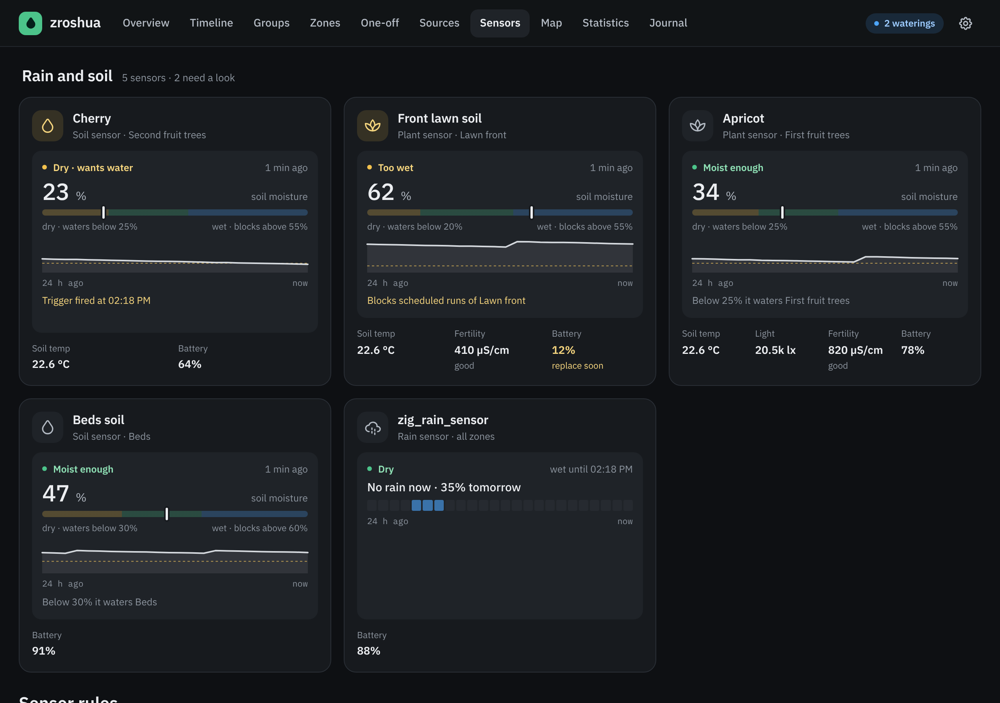

### Site map

Draw your property as an SVG in any editor (Inkscape, Figma, Illustrator) using **any shapes**
— rectangles, paths, polygons, circles — and upload it. Shapes don't need ids; Zroshua adds
them automatically, so a plain Figma export works. In *Assign zones* mode you pick a zone and
tap the shapes that make it up — **a single zone can be several shapes** (a bed drawn as two
rectangles, a lawn split by a path). The map is two-channel: **fill color = watering type**
(sprinkler, drip, beds, lawn, shrubs) so the plan reads like a real garden legend, and **live
state = brightness/animation** — a watering zone brightens and pulses (with its **remaining
minutes** on it), idle is steady, queued shows a moving dashed outline, fault turns red,
disabled fades out. Tapping a zone opens a popup with its status, next run and a water-now
slider. Large plans **zoom and pan** — zoom buttons in the corner and drag to pan on desktop,
**pinch-to-zoom and one-finger drag** on mobile.

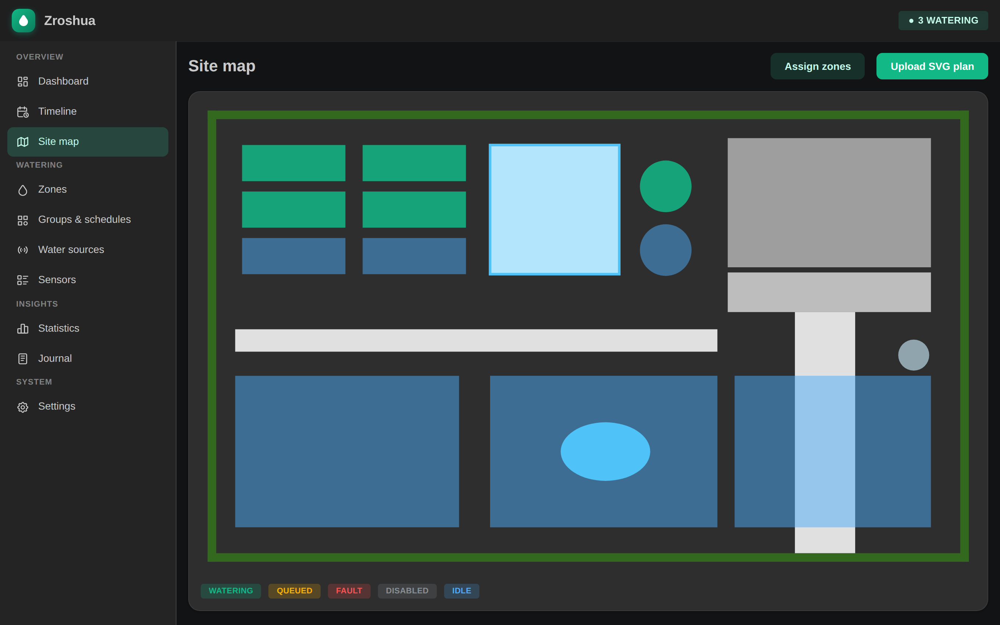

In *Assign zones* mode you pick a zone and paint the shapes that belong to it (green = this
zone, purple = another zone, gray = free):

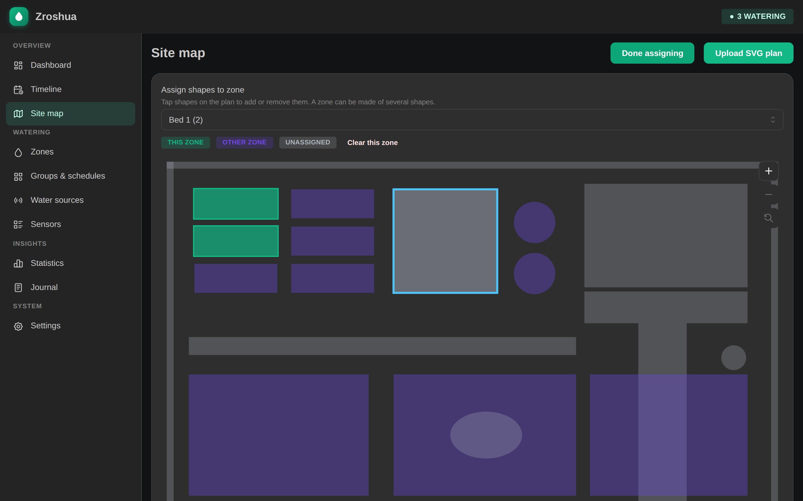

### Statistics

One period for the whole page — week, month or season — then water, pump energy and watering
time as bar charts (tap a bar to read its day), **water by group** and **insights**: runs
skipped for rain, wet soil or a run condition and the water that saved, runs the soil sensors
started, zones not watered in the period. The flow and pressure of a source can be drawn as a
line over the last hours. Calculated liters per run (flow rate × actual duration; ranges give min–max estimates),
minutes and **pump energy measured only while watering** (kWh counters and W power sensors
both work) plus the refill-tail category. Set a tariff and currency to see costs. Daily
charts and CSV export.

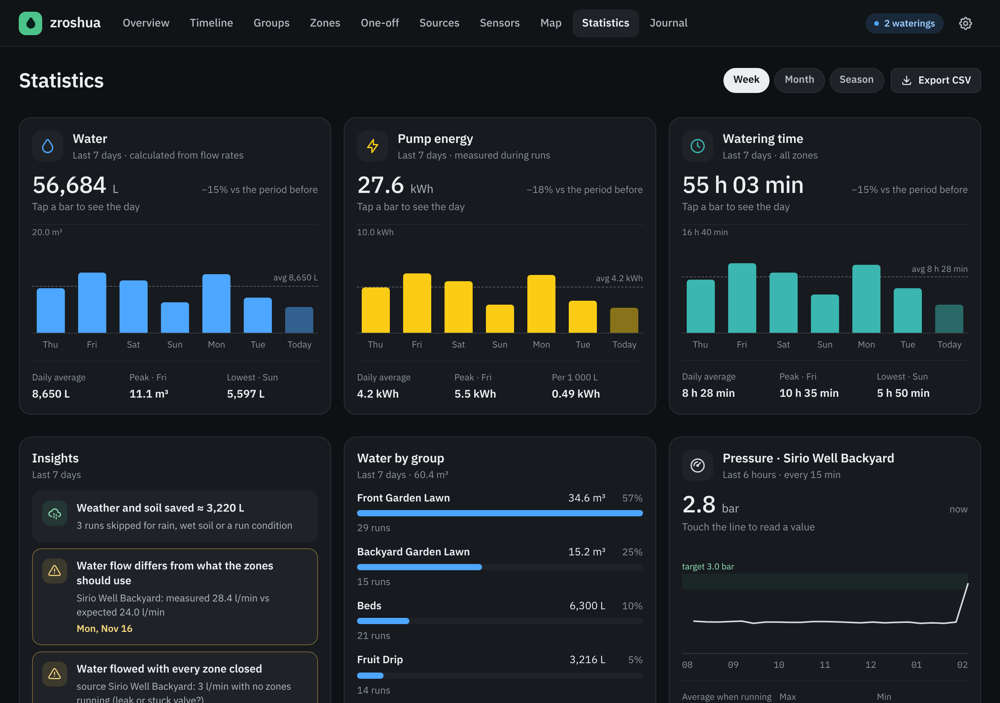

### Journal

Every decision is explainable: run started/finished (duration), **every skip with its
reason** (rain sensor wet, forecast, condition failed, below-minimum rollover, conflict
policy…), temperature adjustments, faults, reconciliations. Filter by **event type** and by
**zone or group** (the picker groups the two and each row is tagged so you always know which
is which). On a phone the log renders as stacked cards instead of a wide table.

Group and zone cards also show **when each was last actually watered** — a skipped run is not
counted, so "last watered" reflects real watering, not the schedule. For a group it is the last
time the *group* ran: watering one of its zones by hand, or by that zone's own schedule or soil
trigger, updates the zone but leaves the group as it was.

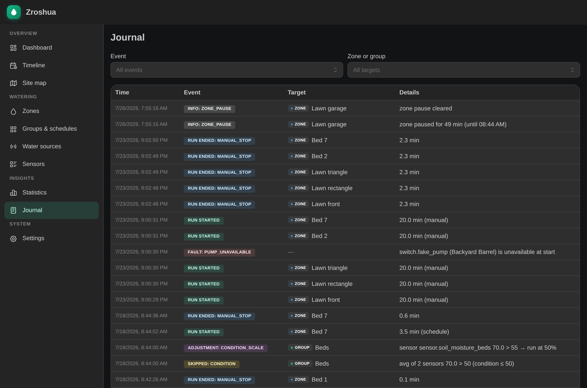

### Settings

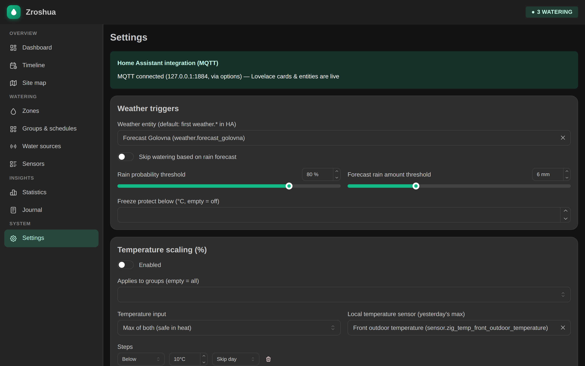

- **Weather triggers**: skip the day when rain probability ≥ X % *and* forecast amount ≥ Y mm;
  freeze protect below a threshold. Location and forecast come from your HA weather entity.
- **Temperature scaling** in percent steps (e.g. below 20 °C → skip; below 25 °C → −10 %;
  above 30 °C → +20 %), driven by the forecast max, **yesterday's max from your own sensor**,
  or a combination. Planning always reserves the worst-case boost, so boosted runs can never
  break group rules.
- **Conflict policy**: wait in queue vs. skip (strict timetable).
- **Pre-start availability check**: if a zone's entity or its source pump is `unavailable`
  within a configurable window (default 30 min) before a scheduled start, you get a fault
  notification naming the exact entity.
- **Notifications**: Telegram (several chat IDs) and/or any HA `notify.*` service, each with
  its own event filter — started, finished (duration + time to next run), skipped (with
  reason), stopped by rain, faults, system. Choose the notification language independently
  of the browser language; message text, reasons, dates and numbers are localized.
  **Group-level mode** collapses a sequential run
  of 13 beds into two messages (started / finished with totals) instead of 26; a **daily
  digest** at a chosen time sums up runs, liters, energy, cost and skips; **quiet hours**
  hold everything except faults during the night.
- **External switch policy**: a zone turned on outside Zroshua is either adopted as a manual
  run (auto-off) or switched back off.
- **Backup**: export/import the whole configuration as JSON.

### Mobile

The UI is mobile-first: on a phone the top navigation becomes a bottom tab bar (Overview,
Zones, Groups, Statistics, More), rows of cards become swipe strips, sheets open from the
bottom and controls are at least 40 px tall. This is how the dashboard looks in the HA
companion app:

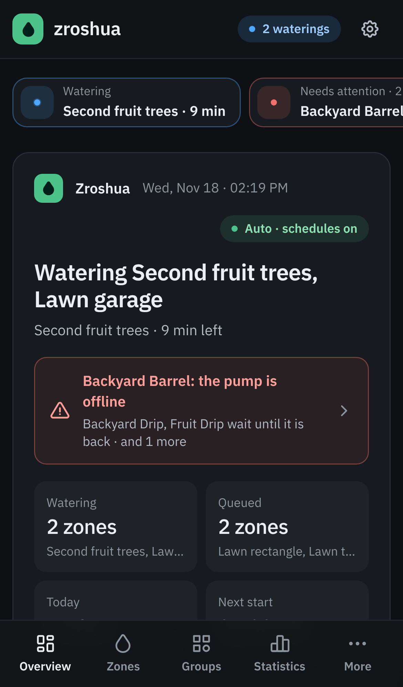

## Reliability guarantees

- **Check-back on every switch**: a zone that fails to turn on is skipped (the rest of the
  plan continues); a zone that fails to turn **off** triggers escalation — source pump
  shutdown, repeated retries, critical notification.
- Independent **max-runtime failsafe** per zone.
- **Restart-safe**: active runs are persisted and resumed; on startup any zone found "on"
  without a matching run is reconciled off.
- Optional **idle-flow leak detection** per source (water flowing while nothing runs).

## Lovelace cards

For controlling irrigation straight from a Home Assistant dashboard — without opening the
add-on — Zroshua ships a custom Lovelace card. When the Mosquitto add-on is present the card
works with **zero setup**: the add-on copies `zroshua-card.js` into `/config/www` and registers
it as a dashboard resource automatically (on YAML-mode dashboards, add the resource
`/local/zroshua-card.js` as a *module* manually).

The card draws **the same cards as the add-on**, with the same anatomy, state words and colours
— its colours are generated from the add-on's design tokens — so a zone looks the same on the
board and inside. One card type, one view per card; the card has a visual editor too:

```yaml
type: custom:zroshua-card
view: status     # see the views below
title: Garden    # optional
```

| View | What it shows |
|---|---|
| `status` | What is happening in one sentence, the running group's zone order, the most important problem, tiles (watering, queued with reasons, today, next start, weather), **Stop all** and **Pause all**. `dashboard` is an alias. |
| `badges` | One compact row of status badges for the top of a board: watering, needs attention, next run, rain sensor, pressure, barrel level, today. |
| `quick` | Quick run: a zone or a group, a duration, the litres and end time, start. |
| `groups` | A card per group: mode, zones on, next start or what it waits for, **Run / Stop group**, pause. |
| `zones` | Every zone, in sections by group, with filter chips — All, Watering, Off, and Queued, Fault, May skip or Paused when there are any; tap a zone for its sheet. Built for dozens of zones. |
| `upcoming` | The next runs with the weather strip; runs that will be skipped (rain dry-out, pause…) say why, uncertain ones get *may skip*. |
| `timeline` | Today as a 24-hour lane per group, with a «now» line. |
| `sources` | Water sources: pump state, pressure gauge with the target, flow, barrel level, what each feeds. |
| `sensors` | Rain and soil sensors with their thresholds, last 24 hours and every reading — moisture, soil temperature, light, fertility, battery. |
| `chart` | A week of water, pump energy or watering time as bars (tap a bar), or the history line of any entity. |
| `insights` | What the last 7 days say: skipped runs and the water saved, soil-triggered runs, water by group. |
| `attention` | Only what needs you — offline pump, quiet or low-battery sensor, a valve that does not answer; «All good» otherwise. |

| Option | |
|---|---|
| `view` | one of the views above, default `status` |
| `title` | replaces the card's own title |
| `metric` | `chart`: `water` (default), `energy` or `time` |
| `entity` | `chart`: draw the history of this entity (a flow, pressure or moisture sensor) instead of a metric |
| `hours` | `chart` with `entity`: how far back, default 24 |
| `limit` | `upcoming`: how many runs, default 6 |
| `open_sections` | `zones`: how many group sections start open (all by default) |
| `theme` | `auto` (follows the Home Assistant dark mode, default), `dark` or `light` |
| `ha_theme` | `true`: surfaces and text follow the dashboard theme |
| `hub` | the hub entity, only if it is not found automatically |

A board that works well on a phone, top to bottom: `badges`, `status`, `quick`, `zones`,
`upcoming`, `sensors`, `sources`, `chart`.

Inside a container card that pages on a swipe, such as
[Deck Card](https://github.com/RobinCK/lovelace-deck-card), the rows that scroll sideways —
groups, sources, the zone filter, the badges — keep their swipe; swipe anywhere else to turn
the page.

The card reads a single hub sensor (published over MQTT) and sends actions back through the
`mqtt.publish` service — so it stays live and needs no per-entity wiring. It locates that
sensor by its attributes, so there is nothing to configure.

> **Requires MQTT.** The cards and the native entities below need a broker. Install the
> **Mosquitto broker** add-on and the **MQTT** integration — credentials are then picked up
> automatically. For an external broker, set `mqtt.host` (and port/username/password) in the
> add-on options. The add-on's **Settings** page shows a live MQTT status banner; if it says
> *MQTT off*, the card will say it is waiting for the hub entity — see
> [Troubleshooting](#the-lovelace-card-says-it-is-waiting-for-the-hub-entity).

| `status` | `badges` + `quick` on a phone |
|---|---|
| 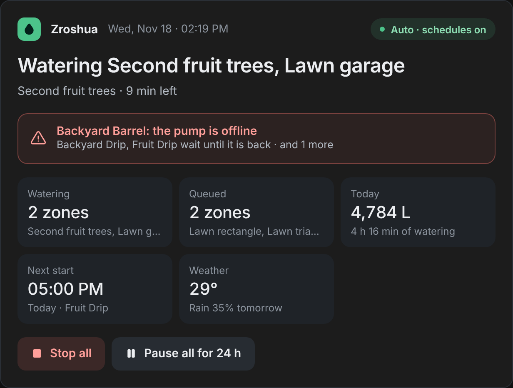 | 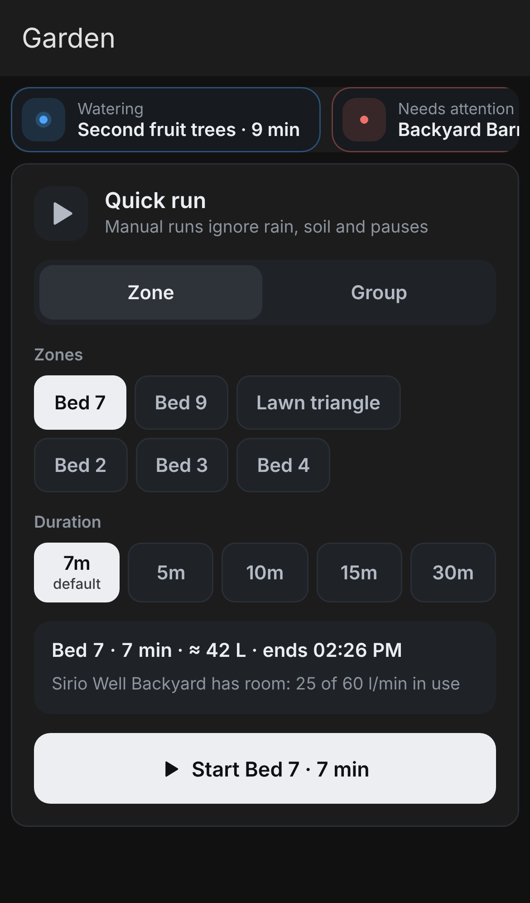 |

| `groups` | `zones` |
|---|---|
| 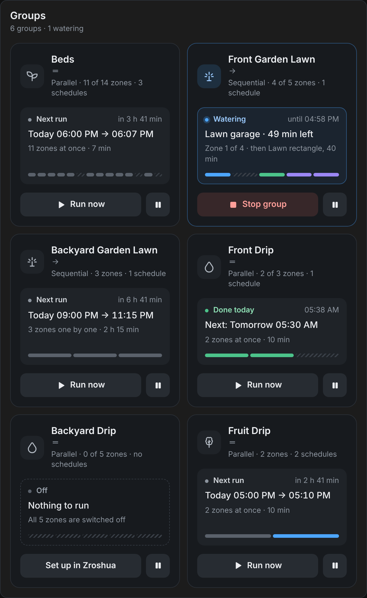 | 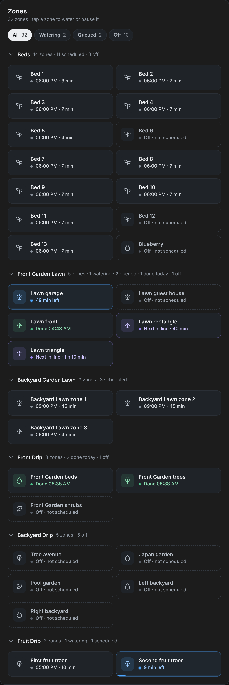 |

| `sources` | `chart` |
|---|---|
| 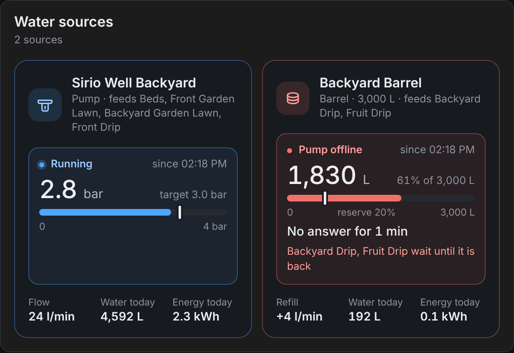 | 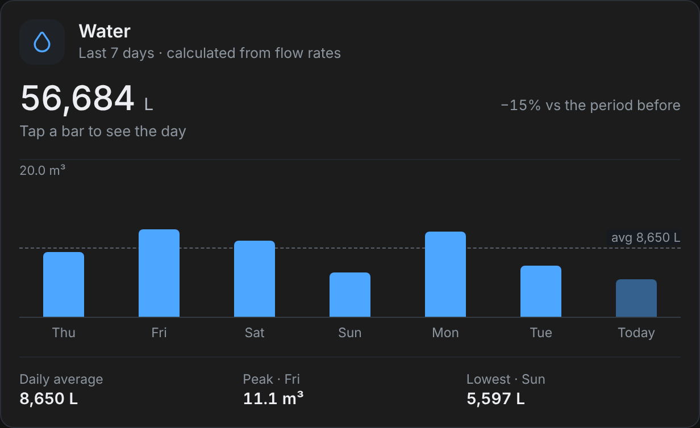 |

| `sensors` | `insights` |
|---|---|
| 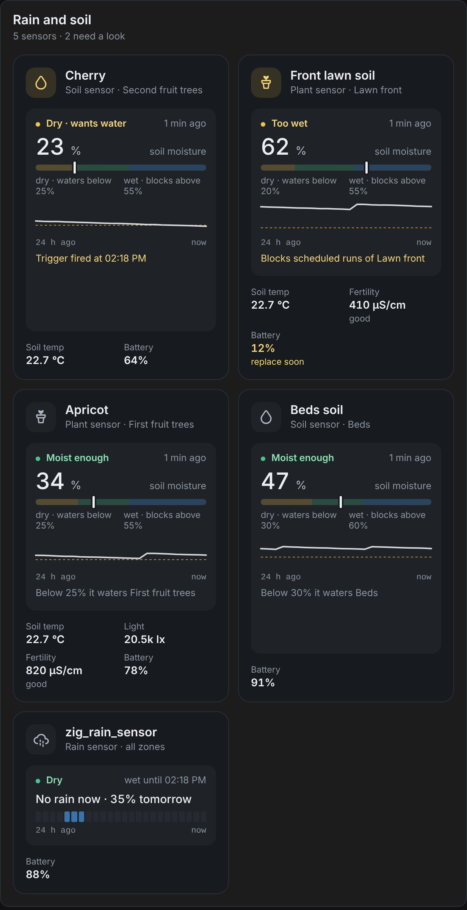 | 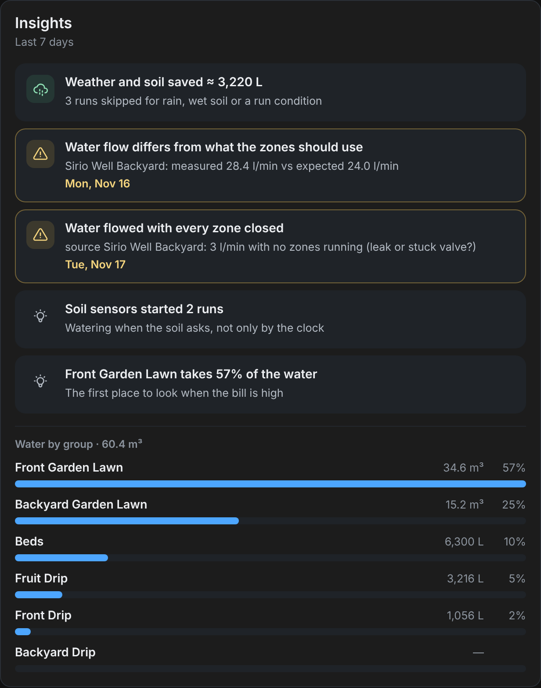 |

| `upcoming` on a phone | `timeline` |
|---|---|
| 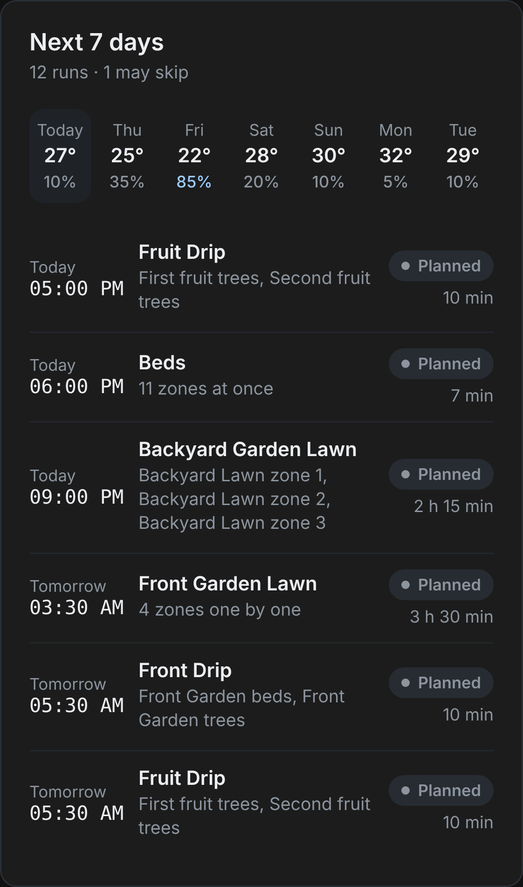 | 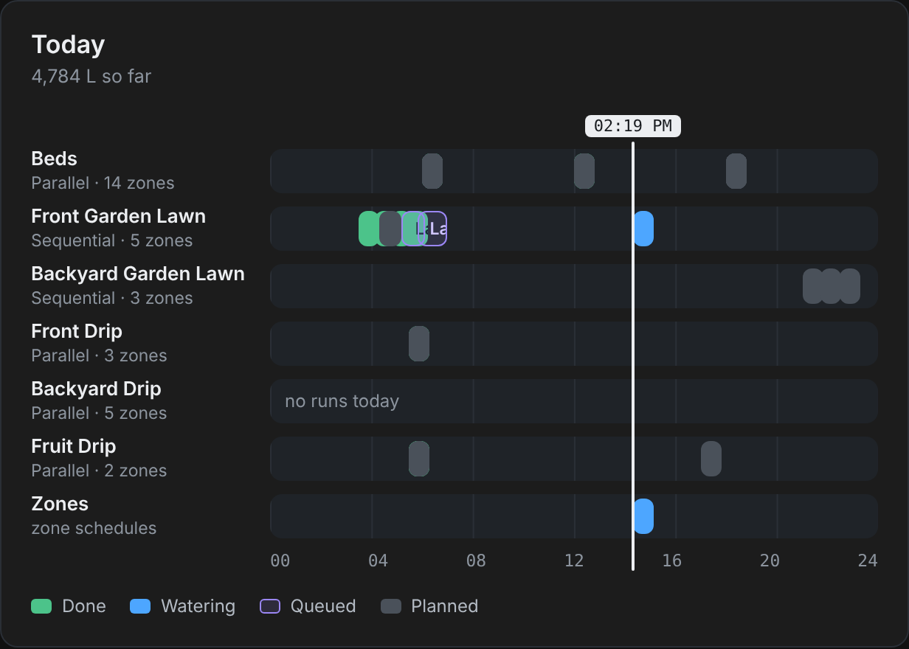 |

Group cards have a **pause** control and the zone sheet a Pause / Resume button, so you can skip
a group or a single zone without disabling it. Tapping a zone opens its sheet over the list —
a bottom sheet on a phone — with the time left, the source, flow, next and last run, and the
one action that fits: water for a preset, stop, `+5 min`, clear a fault:

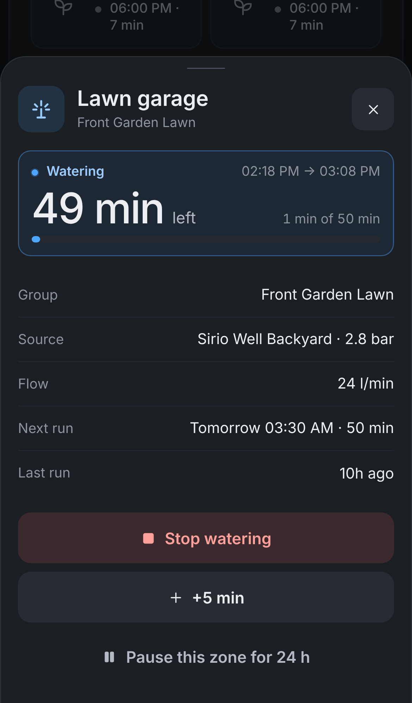

## Native HA entities (MQTT discovery)

With the Mosquitto add-on installed, Zroshua automatically publishes a "Zroshua" device:
per-zone watering switches (turn on = manual run with auto-off), next-watering timestamp
sensors, a watering-active binary sensor, daily water/energy sensors **plus a daily water
sensor per water source** (well vs. barrel), a **level sensor (%) per capacity-tracked
source** and a pause-all switch. The consumption sensors
carry `device_class`/`state_class`, so Home Assistant records long-term statistics — the
built-in *statistics-graph* card charts liters per hour / day / week out of the box, and
the sensors fit the Energy dashboard. Availability uses a Last-Will message, so a dead
add-on shows *unavailable* instead of stale states.

## Documentation

- [Add-on documentation](zroshua/DOCS.md) — the detailed feature guide (also shown in the
  add-on's Documentation tab).

## Development

```bash
# backend (NestJS + TypeORM)
cd zroshua/backend && npm install && npm run build && node dist/main.js
# frontend (React + Vite + Mantine) — dev server proxies /api to :8099
cd zroshua/frontend && npm install && npm run dev
```

### Stand

`ZROSHUA_SIMULATE=1` runs the add-on against an in-process fake Home Assistant with a virtual
garden: 32 zones in 6 groups, a well pump with pressure and flow sensors, a barrel with a level,
rain and soil sensors with history, a weather forecast and a week of statistics. Valves, pumps
and sensors react like real ones, MQTT runs in-process, and nothing touches a real Home
Assistant. The database lives in `zroshua/backend/.sim-data` and is seeded again at every start.

```bash
cd zroshua/frontend && npm install && npm run build
cd ../backend && npm install && npm run dev:sim
```

The panel is on http://localhost:8099, and the Lovelace cards on a page that plays the Home
Assistant frontend on http://localhost:8099/api/dev/cards
(`?layout=phone|desktop&theme=dark|light&views=status,zones`).

| Variable | |
|---|---|
| `ZROSHUA_SIM_SCENARIO` | `summer` (default: a group waters, the barrel pump is offline), `calm` (the same garden, the pump online) or `season_off` (schedules off, a cold week) |
| `ZROSHUA_SIM_RESET=0` | keep the database between starts |
| `ZROSHUA_PORT`, `ZROSHUA_SIM_HA_PORT` | ports, 8099 and 8124 by default |

`npm run smoke` (in `zroshua/backend`, after both builds) starts its own stand and drives the
panel and the card in Chromium with Playwright, on a phone and a desktop, in the dark and the
light theme: every page and every card view renders without console errors, nothing on a phone
scrolls sideways, and the common flows work end to end — water and stop a zone from its sheet,
quick run, skip a run from the next 7 days, pause all, filter zones, tap a chart bar, run a zone
from the card. It uses a global Playwright install.

### UI kit

The panel and the card share one design system, in `zroshua/frontend/src/ui`:

| Layer | |
|---|---|
| `ui/tokens` | the single source of colours, state tones, type, radii and spacing (`base.ts`) |
| `ui/theme` | the Mantine theme and the `--ui-*` CSS variables, generated from the tokens |
| `ui/kit` | primitives: panel, tile, status line and pill, metric, meter, buttons, chips, tabs, action menu, charts, rows, sheet |
| `ui/garden` | irrigation cards built only from the kit: zone tile and board, group, source and sensor cards, status, next 7 days, timeline, quick run, charts, findings |

Pages turn API data into view models (`src/view`) and compose these; nothing under `src/ui`
fetches. Every state — watering, queued, next, done, skip, paused, fault, off — maps to one
tone, so it looks the same on every page and on the board. To recolour, change
`ui/tokens/base.ts` and run `npm run tokens:card`: it regenerates the token block inside
`card/zroshua-card.js`, so the card follows. `npm run check` verifies the layer boundaries,
that the card's tokens are up to date, and the types.

### Releases

A release is a commit that changes `version:` in `zroshua/config.yaml` — that
field is what the Supervisor compares to offer an update, so bump it **last**,
after the change is verified. Add the matching `zroshua/CHANGELOG.md` section in
the same commit, then tag it:

```bash
bash scripts/tag-releases.sh --push
```

The script tags every released version that is not tagged yet, taking the tag
message from that version's changelog section, and is safe to re-run.

### Translations

The UI uses [i18next](https://www.i18next.com/); dictionaries are plain JSON in
`zroshua/frontend/src/locales/`. The key **is** the English source text, so a
missing translation falls back to readable English rather than a blank or a key
name, and `en.json` is the list of source strings.

```bash
cd zroshua/frontend
npm run i18n         # sync the dictionaries with the t() calls in the code
npm run i18n:check   # fail if they are out of date (used in CI)
```

`npm run i18n` adds strings that are new and removes strings that are gone, in
every language at once. To add a language: put its code in `locales` in
`i18next-parser.config.js` and in `SUPPORTED` / `LANG_OPTIONS` in `src/i18n.ts`,
run `npm run i18n`, then fill in the new `<lang>.json`. Untranslated entries are
left as empty strings, so they are easy to find.

Some keys are built at runtime (`t(zone.type)`, `t(weather.condition)`) and
cannot be found by scanning the code — those are declared in
`src/i18n-dynamic.ts`. Plural forms are generated per language from the CLDR
rules, so pass `count`: `t('{count} days ago', { count: 3 })`.

Roadmap: ET/bucket-based suggested durations, volume-based watering, Telegram inline
actions.

## Troubleshooting

### The Lovelace card says it is waiting for the hub entity

The card looks for the Zroshua sensor among Home Assistant's *states*. Two different
situations look identical to it, so check them in this order.

**1. Do the entities exist, and are they enabled?**

Settings → Devices & Services → **MQTT** → the **Zroshua** device. If the page says
something like *"+72 entities not shown"*, they were discovered but are **disabled** —
a disabled entity is not loaded at all, so it has no state and the card cannot see it.
Enable them and the card fills in immediately.

Entities land disabled when *Enable newly added entities* is turned off for the MQTT
integration (Integration → ⋮ → System options), which is easy to forget on a setup with
many devices.

**2. Do they exist at all?**

Developer Tools → States, filter for `zroshua`. Search for the word, not for an exact
id: Home Assistant builds entity ids from the device name, so the hub arrives as
`sensor.zroshua_zroshua_state` on a fresh install, and older installs may carry a
different id. The card finds it either way — it identifies the hub by its attributes,
not by its name — so you never need to set `entity:` in the card config.

If nothing matches, discovery has not reached Home Assistant. Check that HA's MQTT
integration points at the same broker as the add-on (the add-on's **Settings** page shows
which broker it uses), and use *Listen to a topic* on that integration page to subscribe
to `homeassistant/#`. That listener uses Home Assistant's own connection, so if MQTT
Explorer shows the topics but the listener stays empty, the broker is refusing HA access
to `homeassistant/#` — grant the account HA logs in with read and write there.

Note that the add-on's green *MQTT connected* banner only proves its own connection and
login succeeded. It cannot tell whether Home Assistant reads the same broker, and MQTT
3.1.1 does not report a refused publish, so a broker ACL can drop the discovery messages
without either side noticing.

## Other Home Assistant projects

- [Blackout](https://github.com/RobinCK/blackout) — integration for planned and emergency power outages in Ukraine: schedules for 21 regions, the Ukrenergo grid state, outage history and dashboard cards.
- [Sirio Pump Inverter (WiNET)](https://github.com/RobinCK/ha-sirio-winet) — local integration for Italtecnica Sirio pump inverters with the WiNET Wi-Fi module, with a pressure gauge card.
- [Klimo](https://github.com/RobinCK/klimo) — add-on for room-by-room heating and cooling: heat pumps, boilers, air conditioners, heaters and circulation pumps.
- [Metron](https://github.com/RobinCK/lovelace-metron) — Lovelace cards for energy, solar, battery, gas and money: live flows, statistics, forecasts and bills.
- [Varta](https://github.com/RobinCK/lovelace-varta) — Lovelace cards that keep watch over the house: offline devices grouped by hub or integration, and batteries with a replacement forecast.
- [Deye Inverter Card](https://github.com/RobinCK/lovelace-deye-inverter-card) — Lovelace card with the state and live values of Deye/Sunsynk hybrid inverters.
- [Phase Pair Card](https://github.com/RobinCK/lovelace-phase-pair-card) — Lovelace card for three-phase homes: voltage and power before and after the voltage stabilizers, phase balance.
- [Deck Card](https://github.com/RobinCK/lovelace-deck-card) — adaptive container card that groups cards into segments: pills on wide screens, swipe on phones.
- [Osnova](https://github.com/RobinCK/osnova) — theme for the whole Home Assistant interface with a Ukrainian cross-stitch ornament.
- [Solax2HA](https://github.com/RobinCK/solax2ha) — service that sends Solax inverter data to Home Assistant sensors.

## License

MIT
